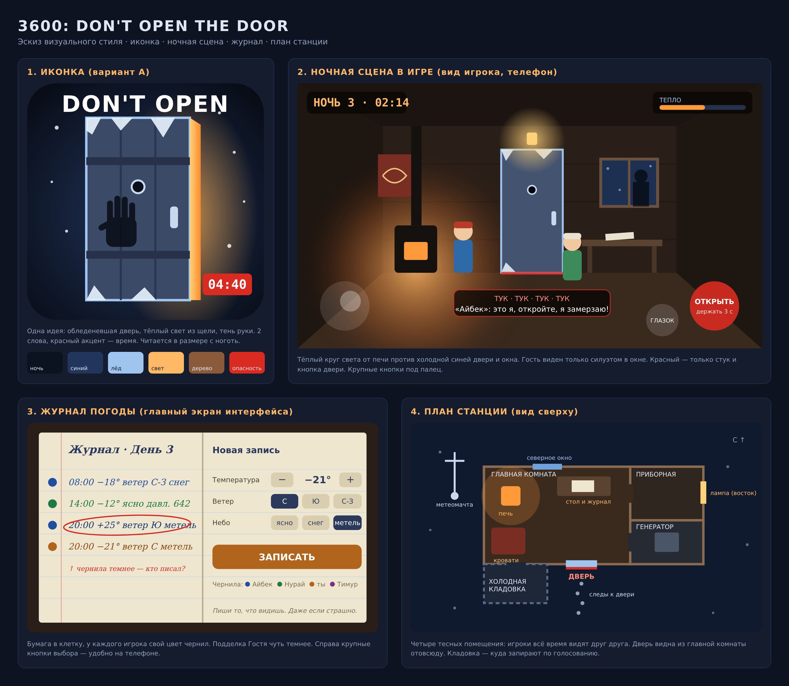

# 3600M

Проекты игр для Roblox. Здесь хранятся дизайн-документы, сценарии, планы и эскизы.
Код прототипа лежит в `src/` (как запустить: `docs/08-code.md`). Черновые макеты экранов: `art/ui/`.

## Игры

| # | Игра | Статус |
|---|---|---|
| 1 | **3600: Don't Open the Door** (режим «Один из нас стучит» + сюжет «40 дней») | Этап 1: подготовка |
| 2 | **Whiteout: Hide Your Heat** (прятки с тепловизором) | Идея |
| 3+ | Быстрые игры на общем движке | Список в `docs/06-plan.md` |

## Документы

| Файл | Что внутри |
|---|---|
| [docs/01-concept.md](docs/01-concept.md) | Концепция «3600», главные «вишенки», визуальный стиль |
| [docs/02-traitor-mode.md](docs/02-traitor-mode.md) | Режим предателя «Один из нас стучит» |
| [docs/03-story-40-days.md](docs/03-story-40-days.md) | Сюжетный режим: механики, 40 дней по дням, концовки |
| [docs/04-design-ideas.md](docs/04-design-ideas.md) | Идеи геймдизайна и план удержания игроков |
| [docs/05-whiteout.md](docs/05-whiteout.md) | Вторая игра: прятки с тепловизором |
| [docs/06-plan.md](docs/06-plan.md) | Этапы, сроки, бюджет, цель «10 игр до осени 2027», запуск |
| [docs/07-tasks-balance.md](docs/07-tasks-balance.md) | Задания на станции, тепло, дверь, способности Гостя, баланс раунда |
| [docs/08-code.md](docs/08-code.md) | Код прототипа: как устроен и как запустить |
| [art/ui/](art/ui/) | Макеты экранов для Figma (SVG) и картинки для просмотра |
| [art/3600-sketch.png](art/3600-sketch.png) | Эскиз стиля: иконка, ночная сцена, журнал, план станции |

